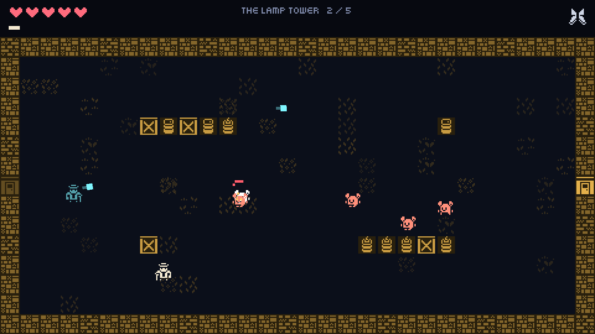

# Echowick (working title)

A room-based roguelite made in Godot 4. You are a lighthouse keeper. Something from
the sea stole the lamp's flame, so you go down three floors to take it back.

**The twist is your echo.** Every room remembers what you did. In the next room a
blue ghost of you repeats it: it walks where you walked and fires when you fired.
Stand close to it and you both fire faster. That is called *Unison*.



> "Echowick" is a placeholder name. Before you commit to it, search Steam to make
> sure no other game uses it. It is set in one place: Project > Project Settings >
> Application > Config > Name, plus the title in `scripts/ui/screens.gd`.

## How to play it

1. Download **Godot 4.7.2** (the standard version, not ".NET") from
   <https://godotengine.org/download/windows/>. It is one zip file. Unzip it anywhere.
2. Download this project: on GitHub press the green **Code** button, then
   **Download ZIP**, and unzip it. (Or use `git clone` if you know git.)
3. Start Godot. Press **Import**, pick the `project.godot` file in this folder, and
   press **Import & Edit**.
4. Wait a few seconds while Godot reads the art and sound.
5. Press **F5** (or the play triangle at the top right). The game starts.

## Controls

| | Keyboard and mouse | Controller |
|---|---|---|
| Move | W A S D or arrow keys | Left stick or d-pad |
| Aim | Mouse | Right stick |
| Fire | Hold left mouse button | Push the right stick, or hold RT / RB |
| Dash (you cannot be hurt while dashing) | Space, Shift or right mouse button | A, LT or LB |
| Pause | Esc or P | Start |
| Fullscreen | F11 or Alt+Enter | |
| Let the bot play / take control back | F9 | |

Menus work with the keyboard, the mouse and the controller.

## How a run works

1. Clear the room. Enemies arrive in waves; a red mark shows where one will appear.
2. Walk to the chest and pick **1 of 3** rewards.
3. The door on the right opens. Walk through it.
4. Each floor is 5 fights and then a boss. There are 3 floors.
5. If your hearts run out, the run is over and you start again from the top.
   Your last moments become the echo in the first room of your next run.

Items stack (take the same one again and it gets stronger) and some pairs form a
**combo** with an extra effect. A card tells you when taking it would finish a combo.

## The test bot

A bot can play the whole game by itself. It uses the same controls a person does.

- **Watch it:** press **F9** during a run. Press F9 again to take control back.
- **Balance check on Windows:** double-click `tools\run_bot.bat`. It plays 30 runs at
  each of three skill levels and writes `docs/balance_report.md`.
  If Windows cannot find Godot, open the `.bat` file in Notepad: the top lines say what
  to do.
- **On Linux or Mac:** `tools/run_bot.sh`

## Where to change things

You do not need to be a programmer for these. Open the file in Godot (double-click it
in the FileSystem panel) or in any text editor.

| I want to change... | Open this file |
|---|---|
| Item names, descriptions and numbers | `scripts/data/item_db.gd` |
| Combo names and what they need | `scripts/data/item_db.gd` (the COMBOS part) |
| Enemy health, speed and behaviour | `scripts/data/enemy_db.gd` |
| How many rooms, which enemies, how hard each floor is | `scripts/data/floor_db.gd` |
| Room floor plans (drawn with letters) | `scripts/data/room_layouts.gd` |
| The keeper's starting numbers | `scripts/player_stats.gd` |
| Colours | `scripts/palette.gd` |
| Which picture is used for what | `scripts/sprites.gd` |
| Which sound plays when, and how loud | `scripts/autoload/sfx.gd` |
| Keys and buttons | In Godot: Project > Project Settings > Input Map |
| Title screen and menu words | `scripts/ui/screens.gd` |

After changing numbers, run the bot again to see what the change did.

## What is where

```
project.godot       the Godot project file
scenes/main.tscn    the one scene; everything else is built by scripts
scripts/            all the game code
  autoload/         things that are always running: run state, settings, sound, controls
  data/             items, enemies, floors, room plans  <- the files you will edit most
  bosses/           the three bosses
  bot/              the test bot and its report writer
  ui/               menus and the heads-up display
assets/             art, fonts and sounds (all listed in CREDITS.md)
tools/              scripts to run the bot
docs/               the balance report and screenshots
CREDITS.md          every asset: name, artist, link, licence
```

## Rules for this project

- Art, music and sound must be made by people and be under a **CC0** or **CC-BY**
  licence. No AI-generated art, music or sound.
- One matching art style: everything visual comes from Kenney's 1-Bit Pack.
- Every asset is listed in `CREDITS.md`. Add the line when you add the asset.

## Status

Playable from start to finish: 3 floors, 13 kinds of enemy, 3 bosses, 33 items and
14 combos. Still to come: options menu, music, more tuning, and the Windows/Steam build.
